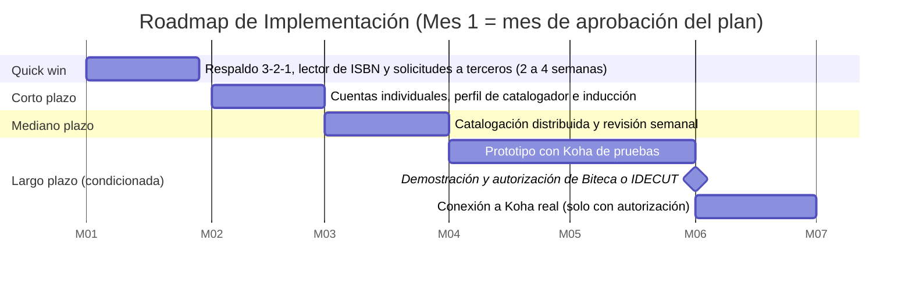

# Plan de Implementación (Roadmap de Transición)

## Cliente
Biblioteca Pública Municipal de Cogua "Rubiel Valencia Cossio" — Alcaldía Municipal de Cogua. Contacto: Ana Cecilia Pastrana Rodríguez, bibliotecaria.

## Integrantes del equipo (ARQUITECH)
- Jorge Alarcón (Jorgealis)
- Julián Aguirre (JulianAguirreUnisabana)
- Brayan Presiga (Brayan-137)

## Propósito de este documento

La solución propuesta (Taller 7) reparte el trabajo de catalogar los libros en Koha entre los estudiantes de servicio social, con cuentas individuales y permisos mínimos, y la apoya con un lector de códigos de barras, copias de seguridad de los archivos y, más adelante, una aplicación propia de carga por lotes. Este plan explica en qué orden y con qué recursos se pasa de la situación actual a esa solución.

Sin este plan, la biblioteca tendría el diseño pero no sabría por dónde empezar, quién debe hacer cada cosa ni qué depende de terceros. Además, la meta de ~3.000 libros en noviembre no se alcanza con el ritmo actual: hacen falta números y hitos acordados con la cliente.

### Capacidad y meta (cuenta de ritmo)

| Dato | Valor | Fuente |
|---|---|---|
| Libros en la colección | 7.000 a 8.000 | Equipo (oct. 2026) |
| Libros en Koha hoy | ~1.100 a 1.200 (al inicio del semestre eran 600 a 700) | Equipo (oct. 2026) |
| Ritmo actual | ~200 libros al mes (≈ 7 a 12 horas semanales de catalogación en total) | Cálculo del equipo |
| Velocidad de catalogación por persona | 4 a 7 libros por hora | Equipo (oct. 2026) |
| Meta | ~3.000 libros en Koha (noviembre) | Cliente |
| Libros que faltan para la meta | ~1.850 → 264 a 463 horas de catalogación | Cálculo del equipo |
| Equivalente en un mes | 61 a 108 horas por semana = 12 a 22 estudiantes con 5 horas semanales | Cálculo del equipo |
| Tiempo para llegar a 3.000 al ritmo actual | ~9 meses | Cálculo del equipo |

Estos números son estimaciones; la línea base real se mide en la fase Quick win (libros por hora antes y después del lector).

## Fases de implementación

Los meses son **relativos**: el Mes 1 es el mes en que la Alcaldía aprueba el plan. Cada fase será un Work Package en la vista ArchiMate de migración.

| Fase | Qué se implementa | Riesgo / brecha que corrige | Esfuerzo | Duración estimada | Responsable sugerido |
|---|---|---|---|---|---|
| Quick win (WP1, WP2) | Respaldo 3-2-1 de los archivos del PC (disco externo y nube institucional); lector de códigos de barras e ISBN y formato corto de catalogación; medición de la línea base de libros por hora; envío de solicitudes formales a Biteca, IDECUT y la Red Nacional (autorización de API o cookies de sesión, respaldos y cumplimiento de la Ley 1581) | R1 (G2), R2 y R6 (G1); solicitudes para R9, R11 y R12 | Bajo | 2 a 4 semanas (Mes 1) | Alcaldía (provee disco, lector y cuenta de nube institucional); bibliotecaria (ejecuta) |
| Corto plazo (WP3, primera parte) | Cuentas individuales en Koha con perfil de catalogador sin acceso a usuarios ni reportes; prueba del perfil con una cuenta de prueba; compromiso de confidencialidad e inducción a los estudiantes | R4 y R5 (G3); parte de R3 | Bajo | Mes 2 | Bibliotecaria (administra las cuentas); Biteca (confirma que el perfil existe en la instancia) |
| Mediano plazo (WP3, segunda parte) | Catalogación distribuida en funcionamiento: guía de catalogación, revisión semanal de una muestra por la bibliotecaria e informe de errores y duplicados | R2, R3 y R6 (G1) | Medio | Mes 3 | Bibliotecaria (revisa) y estudiantes (catalogan) |
| Largo plazo (WP4, condicionada) | Aplicación de carga por lotes: prototipo funcional contra una instancia de Koha de pruebas (instalada desde el repositorio oficial), demostración a Biteca e IDECUT y, solo con autorización, conexión a la instancia real | R2 (G1), R9, R10 y R13 | Alto | Meses 4 a 6 | Equipo ARQUITECH (prototipo); Brayan Presiga (versión final); Biteca o IDECUT (autorización) |

Los riesgos R7 y R8 se aceptan y R11 y R12 se transfieren; se gestionan por gobernanza y por el procedimiento de cambios, no con una fase técnica.

**Por qué este orden.** R4 (cuentas compartidas) tiene prioridad 1 pero esfuerzo bajo, por eso va en Corto plazo y no espera a la catalogación distribuida. El respaldo (R1) y el lector (R2, R6) son de esfuerzo bajo y no dependen de terceros, por eso son el Quick win. La aplicación de lotes tiene el mayor esfuerzo y depende de una autorización externa, por eso va al final.

## Línea de tiempo

## Dependencias entre fases

- **Quick win:** la compra del disco y del lector depende de la Alcaldía; el formato corto puede requerir permiso de Biteca.
- **Corto plazo:** requiere que Biteca confirme que el perfil de catalogador existe en la instancia de Cogua; se verifica con una cuenta de prueba.
- **Mediano plazo:** requiere que las cuentas individuales y el perfil estén probados (Corto plazo).
- **Largo plazo:** el prototipo contra la instancia de pruebas no depende de nadie y puede empezar en el Mes 4. La conexión a la instancia real requiere (1) la autorización de Biteca o IDECUT, solicitada en el Quick win, y (2) un flujo de catalogación estable (Mediano plazo). Mientras no haya autorización, esa parte no se ejecuta; las demás fases no dependen de ella. Al ser una sola persona quien terminará la versión final, el equipo documenta el código y lo guarda en un repositorio compartido (R13).

## Alcance del prototipo de la Fase 2

El diseño del curso termina en la arquitectura; la implementación técnica queda fuera de su alcance. El prototipo es una **extensión voluntaria del equipo** para mostrar a los involucrados (la bibliotecaria, la Alcaldía, Biteca e IDECUT) una versión funcional de la carga por lotes y facilitar su autorización. Se construye y se prueba únicamente contra una **instancia de Koha de pruebas instalada desde el repositorio oficial**, nunca contra el Koha real ni con cookies de sesión de la biblioteca, hasta contar con la autorización escrita (R10).

## Gestión del cambio con las personas

_Se completa en la sesión del 31/10 (Paso 8)._

### Resultado visible por fase

_Se completa en la sesión del 31/10 (Paso 8)._

## Referencias

- Guía paso a paso del Taller 9 (Paso 4), plantilla de plan de implementación.
- Taller 7: matriz de brechas, paquetes de trabajo WP1 a WP5 y matriz de decisión de catalogación.
- Matriz de riesgos arquitectónicos de este taller (`matriz-riesgos.xlsx`).
- TOGAF ADM, Fases E y F (Opportunities & Solutions y Migration Planning).

---

_Este documento hace parte de la entrega final del Taller 9 del curso AREM (Arquitectura Empresarial) - Universidad de La Sabana._
