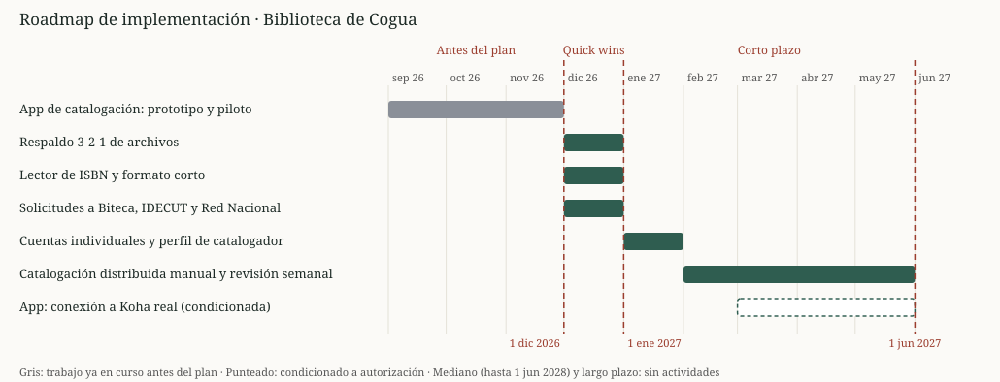

# Plan de Implementación (Roadmap de Transición)

## Cliente
Biblioteca Pública Municipal de Cogua "Rubiel Valencia Cossio" — Alcaldía Municipal de Cogua. Contacto: Ana Cecilia Pastrana Rodríguez, bibliotecaria.

## Integrantes del equipo (ARQUITECH)
- Jorge Alarcón (Jorgealis)
- Julián Aguirre (JulianAguirreUnisabana)
- Brayan Presiga (Brayan-137)

## Propósito de este documento

La solución propuesta (Taller 7) reparte el trabajo de catalogar los libros en Koha entre los estudiantes de servicio social, con cuentas individuales y permisos mínimos, y la apoya con un lector de códigos de barras, copias de seguridad de los archivos y, más adelante, una aplicación propia de carga por lotes. Este plan explica en qué orden y con qué recursos se pasa de la situación actual a esa solución.

Sin este plan, la biblioteca tendría el diseño pero no sabría por dónde empezar, quién debe hacer cada cosa ni qué depende de terceros. Además, la meta de ~3.000 libros en noviembre no se alcanza con el ritmo actual: hacen falta números y hitos acordados con la cliente.

### Capacidad y meta (cuenta de ritmo)

| Dato | Valor | Fuente |
|---|---|---|
| Libros en la colección | 7.000 a 8.000 | Equipo (oct. 2026) |
| Libros en Koha hoy | ~1.100 a 1.200 (al inicio del semestre eran 600 a 700) | Equipo (oct. 2026) |
| Ritmo actual | ~200 libros al mes (≈ 7 a 12 horas semanales de catalogación en total) | Cálculo del equipo |
| Velocidad de catalogación por persona | 4 a 7 libros por hora | Equipo (oct. 2026) |
| Meta | ~3.000 libros en Koha (noviembre) | Cliente |
| Libros que faltan para la meta | ~1.850 → 264 a 463 horas de catalogación | Cálculo del equipo |
| Equivalente en un mes | 61 a 108 horas por semana = 12 a 22 estudiantes con 5 horas semanales | Cálculo del equipo |
| Tiempo para llegar a 3.000 al ritmo actual | ~9 meses | Cálculo del equipo |

Estos números son estimaciones; la línea base real se mide en la fase Quick win (libros por hora antes y después del lector).

## Fases de implementación

Las etapas se cuentan desde **diciembre de 2026**, el mes siguiente a la sustentación: Quick wins durante el primer mes (hasta el **1 de enero de 2027**), Corto plazo hasta el mes 6 (**1 de junio de 2027**), Mediano plazo hasta el mes 18 (**1 de junio de 2028**) y Largo plazo después. El plan no necesita actividades de mediano ni de largo plazo: la solución completa queda en funcionamiento dentro del corto plazo. Cada solución será un Work Package en la vista ArchiMate de migración.

| Solución | Fechas aproximadas | Etapa | Qué se implementa | Riesgo / brecha que corrige | Esfuerzo | Responsable sugerido |
|---|---|---|---|---|---|---|
| App de catalogación: prototipo y piloto | 1 sep. a 30 nov. 2026 (en curso, ~2 meses de avance) | Antes del plan | Prototipo de la app móvil de carga por lotes y piloto con la bibliotecaria contra el Koha de pruebas, para identificar mejoras | R2 (G1), R13 | Alto | Equipo ARQUITECH |
| Respaldo 3-2-1 de archivos (WP1) | 1 a 31 dic. 2026 | Quick win | Copias de los archivos del PC en disco externo y nube institucional | R1 (G2) | Bajo | Alcaldía (provee disco y nube); bibliotecaria (ejecuta) |
| Lector de ISBN y formato corto (WP2) | 1 a 31 dic. 2026 | Quick win | Lector de códigos de barras e ISBN, formato corto de catalogación y medición de la línea base de libros por hora | R2 y R6 (G1) | Bajo | Alcaldía (provee el lector); bibliotecaria |
| Solicitudes a terceros | 1 a 31 dic. 2026 | Quick win | Solicitudes formales a Biteca, IDECUT y la Red Nacional: credencial de servicio con permiso mínimo sobre la API de Koha (opción preferida) o, en su defecto, autorización para usar cookies de sesión; respaldos y cumplimiento de la Ley 1581 | R9, R11 y R12 | Bajo | Bibliotecaria con apoyo del equipo |
| Cuentas individuales y perfil de catalogador (WP3, primera parte) | 1 a 31 ene. 2027 | Corto plazo | Cuentas individuales en Koha con perfil sin acceso a usuarios ni reportes, prueba del perfil, compromiso de confidencialidad e inducción a los estudiantes | R4 y R5 (G3); parte de R3 | Bajo | Bibliotecaria (administra); Biteca (confirma el perfil) |
| Catalogación distribuida manual (WP3, segunda parte) | 1 feb. a 31 may. 2027 | Corto plazo | Guía de catalogación, revisión semanal de una muestra por la bibliotecaria e informe de errores y duplicados | R2, R3 y R6 (G1) | Medio | Bibliotecaria (revisa) y estudiantes (catalogan) |
| App: conexión a Koha real (WP4, condicionada) | 1 mar. a 31 may. 2027 | Corto plazo | Conexión de la app al Koha de la biblioteca, solo con autorización escrita de Biteca o IDECUT | R2 (G1), R9 y R10 | Medio | Brayan Presiga; Biteca o IDECUT (autorización) |

Los riesgos R7 y R8 se aceptan y R11 y R12 se transfieren; se gestionan por gobernanza y por el procedimiento de cambios, no con una solución técnica.

**Trabajo previo.** El equipo empezó a desarrollar la app de catalogación en septiembre de 2026. En noviembre se termina el prototipo con un piloto para identificar mejoras, así que al aprobarse el plan la herramienta ya está lista y solo espera la autorización para conectarse al Koha real.

**Por qué este orden.** El respaldo (R1) y el lector (R2, R6) son de esfuerzo bajo y no dependen de terceros, por eso son Quick wins; las solicitudes a terceros van en el mismo mes porque su respuesta toma tiempo. R4 (cuentas compartidas) tiene prioridad 1 y esfuerzo bajo, por eso las cuentas individuales van primero en el corto plazo, antes de que más estudiantes cataloguen. La conexión de la app empieza en marzo para dar tiempo a la respuesta de Biteca o IDECUT.

## Línea de tiempo

Las líneas verticales punteadas marcan el final de cada etapa.



Versión en Mermaid (respaldo; el final de cada etapa aparece como hito):

```mermaid
gantt
    title Roadmap de implementación (etapas desde dic. 2026)
    dateFormat YYYY-MM-DD
    axisFormat %b %Y
    App de catalogación: prototipo y piloto        :done, a1, 2026-09-01, 2026-11-30
    Fin Quick wins (1 ene 2027)                   :milestone, m1, 2027-01-01, 0d
    Fin Corto plazo (1 jun 2027)                  :milestone, m2, 2027-06-01, 0d
    Respaldo 3-2-1 de archivos                    :b1, 2026-12-01, 2026-12-31
    Lector de ISBN y formato corto                :b2, 2026-12-01, 2026-12-31
    Solicitudes a Biteca, IDECUT y Red Nacional   :b3, 2026-12-01, 2026-12-31
    Cuentas individuales y perfil de catalogador  :c1, 2027-01-01, 2027-01-31
    Catalogación distribuida y revisión semanal   :c2, 2027-02-01, 2027-05-31
    App: conexión a Koha real (condicionada)      :crit, c3, 2027-03-01, 2027-05-31
```

## Dependencias entre soluciones

- **Respaldo y lector:** la compra del disco y del lector depende de la Alcaldía; el formato corto puede requerir permiso de Biteca.
- **Cuentas individuales:** requiere que Biteca confirme que el perfil de catalogador existe en la instancia de Cogua; se verifica con una cuenta de prueba.
- **Catalogación distribuida:** requiere que las cuentas individuales y el perfil estén probados.
- **Conexión de la app:** requiere (1) una vía autorizada para escribir en Koha, solicitada en diciembre: la opción preferida es una credencial de servicio con permiso mínimo sobre la API de Koha, que habilita Biteca; la alternativa, que IDECUT autorice usar cookies de sesión (R10); y (2) el piloto terminado. Mientras no haya autorización, esa parte no se ejecuta; las demás soluciones no dependen de ella. Al ser una sola persona quien terminará la versión final, el equipo documenta el código y lo guarda en un repositorio compartido (R13).

## Alcance del prototipo de la app

El diseño del curso termina en la arquitectura; la implementación técnica queda fuera de su alcance. El prototipo es una **extensión voluntaria del equipo** para mostrar a los involucrados (la bibliotecaria, la Alcaldía, Biteca e IDECUT) una versión funcional de la carga por lotes y facilitar su autorización. Se construye, se prueba y se pilotea únicamente contra una **instancia de Koha de pruebas instalada desde el repositorio oficial**, nunca contra el Koha real ni con cookies de sesión de la biblioteca, hasta contar con la autorización escrita (R10).

## Gestión del cambio con las personas

_Se completa en la sesión del 31/10 (Paso 8)._

### Resultado visible por fase

_Se completa en la sesión del 31/10 (Paso 8)._

## Referencias

- Guía paso a paso del Taller 9 (Paso 4), plantilla de plan de implementación.
- Taller 7: matriz de brechas, paquetes de trabajo WP1 a WP5 y matriz de decisión de catalogación.
- Matriz de riesgos arquitectónicos de este taller (`matriz-riesgos.xlsx`).
- TOGAF ADM, Fases E y F (Opportunities & Solutions y Migration Planning).

---

_Este documento hace parte de la entrega final del Taller 9 del curso AREM (Arquitectura Empresarial) - Universidad de La Sabana._
